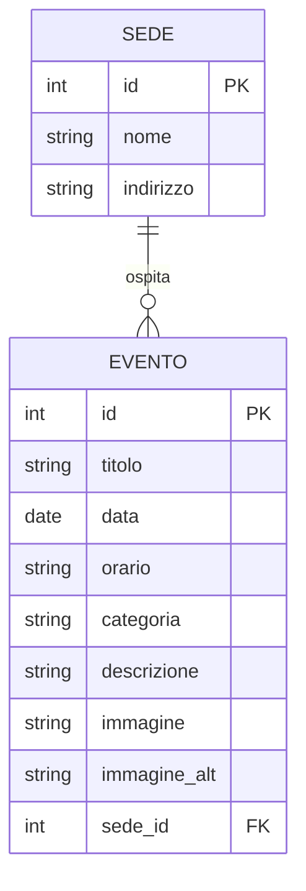

# Scheda dati

## Entità: Evento

| Campo | Tipo | Esempio |
|---|---|---|
| `id` | Numero intero | `1` |
| `titolo` | Testo | `"Lettere in movimento"` |
| `data` | Data in formato `AAAA-MM-GG` | `"2026-06-12"` |
| `orario` | Testo in formato `HH:MM` | `"10:00"` |
| `categoria` | Testo | `"Incontro"` |
| `descrizione` | Testo | `"Come cambia un messaggio quando cambiano le lettere? Un incontro su tipografia, ritmo e comunicazione visiva."` |
| `immagine` | Percorso di un file, testo | `"assets/lettere-in-movimento.svg"` |
| `immagine_alt` | Testo alternativo | `"Lettere geometriche disposte su una griglia"` |
| `sede_id` | Numero intero | `1` |

**Chiave primaria:** `id`, numerico, univoco nell’entità e stabile.

## Entità: Sede

| Campo | Tipo | Esempio |
|---|---|---|
| `id` | Numero intero | `1` |
| `nome` | Testo | `"Officina Nord — Sede centrale"` |
| `indirizzo` | Testo | `"Corso Duca degli Abruzzi 24, Torino"` |

**Chiave primaria:** `id`, numerico, univoco nell’entità e stabile.

## Relazione

Una sede può ospitare più eventi; ogni evento si svolge in una sola sede. Il campo `Evento.sede_id` fa riferimento a `Sede.id`.

## Quantità

Il dataset contiene **6 eventi** e **3 sedi**.

## Aggiornamento dei dati

Chi gestisce il progetto aggiorna gli eventi modificando `eventi.json` e le sedi modificando `sedi.json` nella repository. Dopo le modifiche, pubblica gli aggiornamenti della repository.

## Cosa mostra la pagina

La pagina del programma mostra gli appuntamenti del festival: titolo, data, orario, categoria, descrizione, immagine e sede di ciascun evento.

## Schema Evento–Sede

